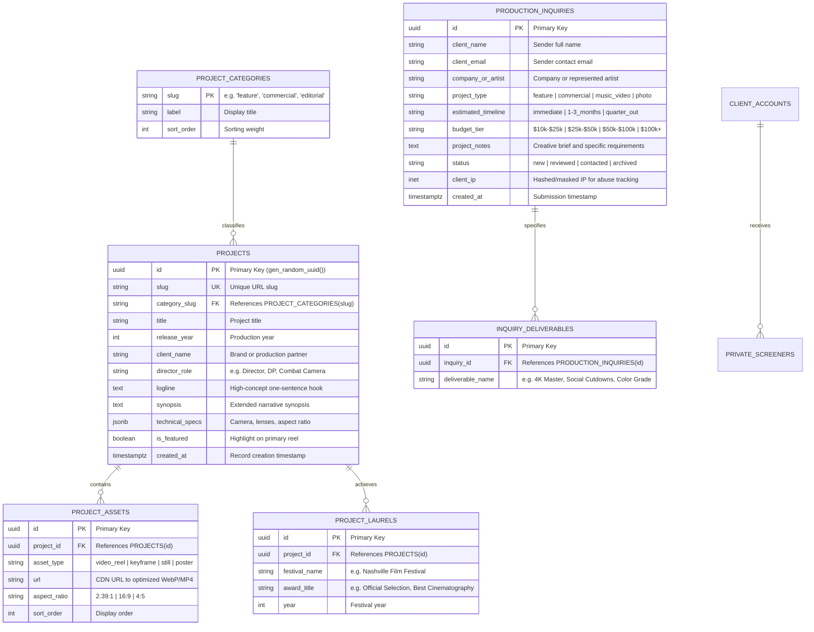

# Database Specification & Data Architecture (DATABASE.md)

## Project: Citadel Productions & Attikus Ebenhack Portfolio
**Document Status:** Approved Database Source of Truth  
**Author:** Senior Database Architect & Backend Engineer  
**Version:** 2.0 (React + GSAP Modernization)  
**Parent Documents:** [PRD.md](file:///d:/LAB-S/attikus-portfolio/PRD.md) | [ARCHITECTURE.md](file:///d:/LAB-S/attikus-portfolio/ARCHITECTURE.md)  

---

## 1. Database Technology & Data Tier Strategy

### 1.1 Architectural Rationale: Dual-Tier Data Model
To maximize performance, ensure zero operational costs, and achieve sub-$50\text{ms}$ global response times, the application uses a dual-tier strategy:

1. **Tier 1 (MVP — In-Memory Static Typed Datastore):**
   - Implemented in TypeScript interfaces and immutable data modules (`src/data/projects.ts`, `src/data/photography.ts`).
   - Serves all public media, feature slates (*The Mutiny*, *Before The Glow*), director credentials, and film festival accolades.
   - Requires zero database connections, zero connection pooling, and provides $0\text{ms}$ latency.
2. **Tier 2 (Production Lead Capture & Phase 2 CMS — PostgreSQL via Supabase):**
   - Manages incoming production brief inquiries, scope estimates, and private screener access logs.
   - Provides Row-Level Security (RLS), ACID guarantees, and automated daily backups.

---

## 2. Entity-Relationship Diagram (ERD)



---

## 3. Tables & Schema Specifications

### 3.1 Table: `projects`
Stores public-facing film slates, commercial campaigns, and editorial showcases.

```sql
CREATE TABLE public.projects (
    id UUID PRIMARY KEY DEFAULT gen_random_uuid(),
    slug VARCHAR(120) NOT NULL UNIQUE,
    category_slug VARCHAR(50) NOT NULL REFERENCES public.project_categories(slug) ON DELETE RESTRICT,
    title VARCHAR(200) NOT NULL,
    release_year SMALLINT NOT NULL CHECK (release_year BETWEEN 2010 AND 2100),
    client_name VARCHAR(150),
    director_role VARCHAR(100) NOT NULL DEFAULT 'Director / Cinematographer',
    logline TEXT NOT NULL,
    synopsis TEXT,
    technical_specs JSONB NOT NULL DEFAULT '{
        "camera": "Arri Alexa Mini LF",
        "lenses": "Atlas Orion Anamorphic",
        "aspectRatio": "2.39:1"
    }'::jsonb,
    is_featured BOOLEAN NOT NULL DEFAULT false,
    created_at TIMESTAMPTZ NOT NULL DEFAULT timezone('utc', now()),
    updated_at TIMESTAMPTZ NOT NULL DEFAULT timezone('utc', now())
);
```

### 3.2 Table: `production_inquiries`
Stores leads generated by the interactive Production Brief Estimator.

```sql
CREATE TABLE public.production_inquiries (
    id UUID PRIMARY KEY DEFAULT gen_random_uuid(),
    client_name VARCHAR(120) NOT NULL,
    client_email VARCHAR(255) NOT NULL CHECK (client_email ~* '^[A-Za-z0-9._%+-]+@[A-Za-z0-9.-]+\.[A-Za-z]{2,}$'),
    company_or_artist VARCHAR(150) NOT NULL,
    project_type VARCHAR(50) NOT NULL,
    estimated_timeline VARCHAR(50) NOT NULL,
    budget_tier VARCHAR(50) NOT NULL,
    project_notes TEXT NOT NULL,
    status VARCHAR(30) NOT NULL DEFAULT 'new' CHECK (status IN ('new', 'reviewed', 'contacted', 'archived')),
    client_ip INET,
    created_at TIMESTAMPTZ NOT NULL DEFAULT timezone('utc', now())
);
```

---

## 4. Constraints, Validation & Indexes

### 4.1 Indexes for Query Optimization
```sql
-- Fast lookup for category-filtered portfolio queries
CREATE INDEX idx_projects_category_year ON public.projects (category_slug, release_year DESC);

-- Fast retrieval of featured works for the Hero & Feature Slates
CREATE INDEX idx_projects_featured ON public.projects (is_featured) WHERE is_featured = true;

-- Status and chronological indexing for production inquiries
CREATE INDEX idx_inquiries_status_date ON public.production_inquiries (status, created_at DESC);
```

### 4.2 Data Validation Constraints
- `client_email` verified via regex constraint at the database layer.
- `release_year` constrained between 2010 and 2100 to prevent corrupted historical inputs.
- `status` locked to an explicit enumeration (`new`, `reviewed`, `contacted`, `archived`).

---

## 5. Ownership, Security & Row-Level Security (RLS)

PostgreSQL Row-Level Security is strictly enabled on all tables:

```sql
ALTER TABLE public.projects ENABLE ROW LEVEL SECURITY;
ALTER TABLE public.project_assets ENABLE ROW LEVEL SECURITY;
ALTER TABLE public.production_inquiries ENABLE ROW LEVEL SECURITY;

-- 1. Public Read-Only Access for Projects & Media
CREATE POLICY "Public can view published projects"
    ON public.projects FOR SELECT
    USING (true);

CREATE POLICY "Public can view project assets"
    ON public.project_assets FOR SELECT
    USING (true);

-- 2. Inquiry Submission: Public Anonymous Insert Only (No Public Select)
CREATE POLICY "Public can submit production brief"
    ON public.production_inquiries FOR INSERT
    WITH CHECK (true);

-- 3. Studio Admin Full Access (Authenticated Service Role)
CREATE POLICY "Admin full access to inquiries"
    ON public.production_inquiries FOR ALL
    TO authenticated
    USING (auth.jwt() ->> 'role' = 'studio_admin')
    WITH CHECK (auth.jwt() ->> 'role' = 'studio_admin');
```

---

## 6. Sensitive Data Handling & Privacy

1. **No Payment/Credit Card Data:** Financial transactions and banking details are completely out-of-scope; no financial instruments touch the database.
2. **Client Email Protection:** Client emails from brief submissions are restricted exclusively to authenticated admin access; public API queries never return inquiry tables.
3. **IP Masking:** Submitter IP addresses (`client_ip`) are stored solely for automated sliding-window rate limiting and deleted after 30 days.

---

## 7. Migration, Seed & Backup Strategy

### 7.1 Seed Strategy
The database is seeded directly from the validated TypeScript project records (`src/data/projects.ts`):
- Flagship feature slates: *The Mutiny* and *Before The Glow*.
- Commercial campaigns: Nike, Red Bull, Nashville artist showcases.
- Editorial fashion lookbooks: *Photo By Attikus*.

### 7.2 Backup & Disaster Recovery
- **Continuous WAL Archiving:** Point-in-time recovery (PITR) up to 7 days.
- **Daily Automated Snapshots:** Full encrypted logical backups stored across multi-region cloud storage.
