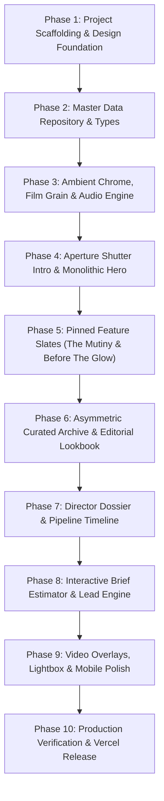

# Phased Implementation Plan (PLAN.md)

## Project: Citadel Productions & Attikus Ebenhack Portfolio
**Document Status:** Approved Engineering Implementation Roadmap  
**Author:** Senior Technical Lead  
**Target:** React + GSAP Modernization (v2.0)  
**Parent Documents:** [PRD.md](file:///d:/LAB-S/attikus-portfolio/PRD.md) | [DESIGN.md](file:///d:/LAB-S/attikus-portfolio/DESIGN.md) | [ARCHITECTURE.md](file:///d:/LAB-S/attikus-portfolio/ARCHITECTURE.md) | [DATABASE.md](file:///d:/LAB-S/attikus-portfolio/DATABASE.md) | [API.md](file:///d:/LAB-S/attikus-portfolio/API.md) | [AGENTS.md](file:///d:/LAB-S/attikus-portfolio/AGENTS.md)  

---

## Phase Overview & Dependency Hierarchy

---

## Phase Breakdown

### Phase 1: Project Scaffolding & Design System Setup
- **Goal:** Establish a modern, high-performance React 18 + Vite + TypeScript + Tailwind CSS project foundation with GSAP installed.
- **Tasks:**
  1. Initialize `package.json` with React, React-DOM, TypeScript, Vite, Tailwind CSS, Autoprefixer, PostCSS, Lucide-React, and GSAP (`gsap`, `@gsap/react`).
  2. Configure `vite.config.ts` and `tsconfig.json` with strict type checking.
  3. Configure `tailwind.config.js` with DESIGN.md color tokens (`--surface-void`, `--gold-pure`, etc.) and typography font families (`Cinzel`, `Syne`, `Space Mono`, `Plus Jakarta Sans`).
  4. Create `src/styles/globals.css` with 35mm film grain SVG filter, anamorphic glow utilities, and custom scrollbar styles.
- **Files Affected:** `package.json`, `vite.config.ts`, `tsconfig.json`, `tailwind.config.js`, `src/styles/globals.css`, `index.html`.
- **Dependencies:** None.
- **Completion Criteria:** `npm run dev` and `npm run build` execute with 0 errors.

---

### Phase 2: Master Data Repository & Typing Layer
- **Goal:** Structure and validate the domain data model in TypeScript for all film slates, commercial campaigns, and photo collections.
- **Tasks:**
  1. Define interfaces in `src/types/project.ts` and `src/types/inquiry.ts`.
  2. Populate `src/data/projects.ts` with authentic feature slates (*The Mutiny*, *Before The Glow*), technical specs (Arri LF, Atlas Anamorphic), and commercial credits.
  3. Populate `src/data/photography.ts` with *Photo By Attikus* editorial series and EXIF camera data.
- **Files Affected:** `src/types/project.ts`, `src/types/inquiry.ts`, `src/data/projects.ts`, `src/data/photography.ts`.
- **Dependencies:** Phase 1.
- **Completion Criteria:** All media collections export strongly typed records with zero TypeScript compiler warnings.

---

### Phase 3: Global HUD, Ambient Film Grain & Audio Engine
- **Goal:** Implement the ambient visual atmosphere and procedural audio system.
- **Tasks:**
  1. Build `src/components/layout/FilmGrainOverlay.tsx` and anamorphic horizon glow line.
  2. Implement `src/hooks/useAudioSynthesizer.ts` utilizing native Web Audio API for tactical clicks and ambient cinema drone (muted by default).
  3. Build `src/components/layout/NavigationHUD.tsx` with responsive navigation links and the interactive audio toggle.
  4. Build `src/components/common/CustomCursor.tsx` with GSAP magnetic lag and hover expansion.
- **Files Affected:** `src/components/layout/FilmGrainOverlay.tsx`, `src/components/layout/NavigationHUD.tsx`, `src/hooks/useAudioSynthesizer.ts`, `src/components/common/CustomCursor.tsx`, `src/context/UIContext.tsx`.
- **Dependencies:** Phase 2.
- **Completion Criteria:** HUD floats cleanly with backdrop-filter blur; sound synthesizer triggers tactile feedback upon user opt-in; custom cursor glides at 60fps.

---

### Phase 4: Aperture Shutter Intro & Monolithic Hero
- **Goal:** Create the signature film clapper opening animation and high-impact hero spread.
- **Tasks:**
  1. Implement `src/components/sections/ApertureHero.tsx`.
  2. Build dual horizontal aperture shutters that open vertically with GSAP `power4.inOut` easing.
  3. Display camera clapper timecode ticker (`00:00:00:24`) and live red tally record indicator.
  4. Render monolithic `Cinzel` headline: "WHERE VISIONS BECOME LEGEND" with combat camera provenance subtitle and showreel CTA.
- **Files Affected:** `src/components/sections/ApertureHero.tsx`.
- **Dependencies:** Phase 3.
- **Completion Criteria:** Aperture shutter smoothly uncurtains into the hero section; hero elements stagger in with zero layout shifts.

---

### Phase 5: Pinned Feature Slates (The Mutiny & Before The Glow)
- **Goal:** Build the flagship feature film showcase using pinned GSAP ScrollTrigger timelines.
- **Tasks:**
  1. Implement `src/components/sections/FeatureSlates.tsx`.
  2. Configure ScrollTrigger pinning so each film locks into place during narrative reading.
  3. Implement asymmetrical layout: 7-column 2.39:1 widescreen keyframe on one side, 5-column technical specs & logline on the opposite.
  4. Add interactive "VIEW PROJECT DOSSIER" trigger.
- **Files Affected:** `src/components/sections/FeatureSlates.tsx`, `src/hooks/useGSAPScroll.ts`.
- **Dependencies:** Phase 4.
- **Completion Criteria:** Smooth scroll scrubbing pins slates cleanly without scroll jerking or jumping; key visuals scale gracefully.

---

### Phase 6: Asymmetric Curated Archive & Editorial Lookbook
- **Goal:** Implement the commercial portfolio and *Photo By Attikus* fashion galleries, eliminating 3x3 uniform SaaS cards.
- **Tasks:**
  1. Implement `src/components/sections/CuratedArchive.tsx` with dynamic category filtering (All, Narrative, Commercial, Editorial).
  2. Build variable-height masonry layout where cards break out of rigid rectangles.
  3. Implement inline video scrub on hover for commercial cuts.
  4. Implement `src/components/sections/PhotoLookbook.tsx` with high-fashion portrait spreads.
- **Files Affected:** `src/components/sections/CuratedArchive.tsx`, `src/components/sections/PhotoLookbook.tsx`.
- **Dependencies:** Phase 5.
- **Completion Criteria:** Switching categories triggers smooth GSAP layout transitions; variable aspect ratios render harmoniously without boxy card borders.

---

### Phase 7: Director Dossier & Pipeline Timeline
- **Goal:** Showcase Attikus Ebenhack’s Combat Camera military veteran background, directorial ethos, and 5-stage concept-to-screen pipeline.
- **Tasks:**
  1. Implement `src/components/sections/DirectorBio.tsx` using an editorial magazine two-page spread layout with full-bleed portraiture.
  2. Implement `src/components/sections/Pipeline.tsx` featuring an animated milestone line with GSAP timeline markers instead of 5 identical numbered boxes.
- **Files Affected:** `src/components/sections/DirectorBio.tsx`, `src/components/sections/Pipeline.tsx`.
- **Dependencies:** Phase 6.
- **Completion Criteria:** Editorial text wraps organically around the portrait; pipeline milestones illuminate sequentially as the user scrolls.

---

### Phase 8: Interactive Brief Estimator & Lead Engine
- **Goal:** Build the interactive project scope estimator for incoming agency and brand leads.
- **Tasks:**
  1. Implement `src/components/sections/BriefEstimator.tsx`.
  2. Build scope selectors (Feature Film, Commercial, Music Video, Editorial Photo).
  3. Build interactive timeline and budget tier selectors.
  4. Implement minimalist border-bottom input fields with floating labels.
  5. Add client-side validation, honeypot anti-spam field, and submission state feedback.
- **Files Affected:** `src/components/sections/BriefEstimator.tsx`, `src/hooks/useBriefEstimator.ts`.
- **Dependencies:** Phase 7.
- **Completion Criteria:** Calculating brief updates the live slate summary; submitting provides instant on-screen transmission receipt.

---

### Phase 9: Modals, Video Overlays & Mobile Polish
- **Goal:** Build full-screen 4K video player overlays, photo lightboxes, and optimize for touch devices.
- **Tasks:**
  1. Build `src/components/modals/VideoPlayerModal.tsx` with 2.39:1 letterboxing and lights-down dimming.
  2. Build `src/components/modals/LightboxModal.tsx` with keyboard navigation and camera EXIF readouts.
  3. Verify touch interactions on mobile breakpoints ($360\text{px} - 768\text{px}$).
- **Files Affected:** `src/components/modals/VideoPlayerModal.tsx`, `src/components/modals/LightboxModal.tsx`, `src/App.tsx`.
- **Dependencies:** Phase 8.
- **Completion Criteria:** Esc key and backdrop clicks dismiss overlays; mobile layout performs smoothly at 60fps with native touch inertia.

---

### Phase 10: Production Verification & Vercel Release
- **Goal:** Audit performance, accessibility, build optimization, and push the live React + GSAP release to Vercel.
- **Tasks:**
  1. Run `npm run build` and resolve any type/lint issues.
  2. Audit Lighthouse scores ($\ge 90$ performance target).
  3. Commit and push to `main`, verifying live deployment on `https://attikus-portfolio-ten.vercel.app`.
- **Files Affected:** All project files, `.github/workflows/pages.yml`.
- **Dependencies:** Phases 1–9.
- **Completion Criteria:** Live URL serves the modern React + GSAP anti-boxy experience with zero console errors.

---

## Recommended First Task
**Execute Phase 1:** Initialize the React + Vite + TypeScript + GSAP foundation and configure the design tokens in `tailwind.config.js` and `src/styles/globals.css`.
